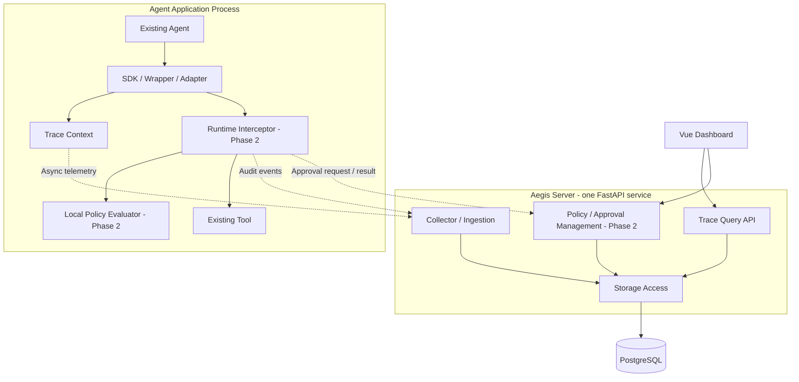

# Aegis Architecture

SPEC-028的Application.graph借用原SDK适配，限定invoke/ainvoke/stream/astream/with_config。流从首次拉取至EOF或清理成功持有租约，跨yield不附着OTel上下文；清理失败保留租约并禁止再拉取，宿主需显式完成清理。模型客户端、图和checkpointer所有权仍属宿主，原配置/审批协议保持；见[统一流式接入](docs/managed-graph-stream.md)。

SPEC-027在v3配置中加入reviewed_graph及固定图ID/版本/节点，用app.reviewed_graph_tool装配原013–015同步/异步图驱动。Application租约覆盖中断节点、prepare和整个恢复/图继续；客户端、图和SQLite仍由宿主拥有。精确snapshot绑定和永久消费claim保持，业务完成与图checkpoint并非共同事务；见[配置持久图](docs/configured-graph.md)。

SPEC-026在Application v2绑定中区分direct/reviewed并固定工具版本，禁止普通工具入口降级；生命周期租约包裹原ReviewedTool/AsyncReviewedTool的prepare/resume，客户端借用不转移资源所有权。完整参数披露仍显式，原审批协议/HMAC/永久消费claim不变，见[配置审批](docs/configured-review.md)。

SPEC-025新增Runtime.application，将严格配置/Policy快照、显式工具注册和自有SDK生命周期装配成进程内接入边界。宿主传入subject，配置取权限；RLock与调用租约拒绝进行中关闭，资源关闭只针对自身句柄。inspect只检查本地配置/环境/元数据。原Runtime/Policy和平台协议不变，见[统一接入](docs/application-onboarding.md)。

SPEC-024以仓库脚本连接021事件导出与纯Policy.evaluate。read_bundle从同一次有界读取返回已验证manifest/事件，verify_bundle旧返回值不变；回放保留原事件结果并新增候选决策，不重跑工具。没有可信历史Policy全文，revision相同不等于配置相同；状态只对已接收事件负责。见[回放指南](docs/event-policy-replay.md)。

SPEC-023的comparison模块复用工作台快照和求值器，比较规范规则内容与用例前后决策；规范指纹变化或基准用例不符即review_required。它不加载策略到Runtime、修改审批绑定或认证身份；完整流程见[策略变更评估](docs/policy-comparison.md)。服务API、四迁移与Runtime实现保持。

SPEC-022在Policy包增加独立workbench模块与CLI，复用既有evaluate，提供严格JSON文件/套件、决策解释、规范指纹与用例覆盖报告。报告不参与Runtime授权或审批绑定，覆盖仅对给定用例；原Policy/Rule/Decision、服务API与四迁移不变。见[策略工作台](docs/policy-workbench.md)。

SPEC-021的仓库CLI从020现有只读接口分页导出到独占本地目录，JSONL为整数原本、CSV便于查看，manifest最后提交。离线verify核对固定文件哈希/长度、事件配对/排序/筛选、CSV及摘要，不访问服务或执行工具。无API/迁移/SDK变化；客户端跨页检查无法提供数据库快照，清单哈希不是来源认证。见[导出边界](docs/security-export.md)。

当前完整接口以[SPEC-020 OpenAPI](specs/020-security-events/contracts/openapi.json)为准，下文编号章节保留各阶段的历史契约和边界。

平台运行不需要 LLM：Runtime 使用本地确定性策略，Collector/数据库/Dashboard 负责数据接收、存储与展示。Agent 侧可选模型 Wrapper 记录调用的开始/结束和耗时；OpenAI/DeepSeek SDK 是可选集成依赖，不是 Aegis 平台的模型服务依赖。流式 Span 覆盖调用及消费生命周期，不声称代表服务端纯推理耗时、首 Token 延迟或未接入调用的自动发现。

状态：目标架构与已实现边界。SDK 基础追踪见 [SPEC-001](specs/001-python-sdk/spec.md)，网络导出、Collector、查询、PostgreSQL 迁移和 Compose 配置见 [SPEC-002](specs/002-collector/spec.md)。Dashboard 已按 [SPEC-003](specs/003-dashboard/spec.md) 实现原生 Trace 可视化；OpenAI LLM 与节点用量已按 [SPEC-004](specs/004-openai/spec.md) 完成离线验收；SPEC-009 已实现进程内 allow / deny，审批与恢复仍待实现。阶段定义以 [ROADMAP.md](ROADMAP.md) 为准。

## 1. 架构目标

Aegis 接入已有 Agent 应用，建立 Agent Run、LLM Call、Tool Call 的关联上下文，并逐步在工具执行前加入治理能力。首版重点是一个可验证的端到端闭环和简洁的接入体验。

核心采用框架无关的 Trace 与 Action 契约。具体框架钩子属于适配器，存储与展示属于服务端，实际工具执行仍由 Agent 应用负责。

## 2. 逻辑组件与部署单元



图中展示完整目标控制路径。Phase 1 只运行观测链路；SPEC-009 增加本地 allow / deny，SPEC-010/011/012扩展审批记录与显式同步/异步工具恢复。SPEC-013进一步加入同步单个LangGraph中断；通用Control API及图异步/跨进程checkpoint恢复仍为后续能力。

| 组件 / 目录 | 负责 | 依赖边界 |
| --- | --- | --- |
| `sdk/python` | 用户 API、上下文传播、Span、脱敏、批量导出、适配器 | 核心不依赖框架；可选集成依赖分别声明 |
| `runtime` | Action 上下文、受保护工具拦截、决策执行、审批等待 | 不依赖 FastAPI 或数据库；不通过 UI 执行工具 |
| `policy-engine` | 权限匹配、策略求值、决策与原因 | 首个实现是可由 Runtime 调用的模块，不单独部署 |
| `collector` | 接收与校验、持久化、查询；后续策略/审批管理 | 通过存储层访问 PostgreSQL，不导入框架适配器 |
| `dashboard` | Trace 列表、树、时间线；后续治理页面 | 仅访问 Server API，不直接访问数据库 |
| `examples` | 原生 Python 和成熟框架的可复现接入示例 | 验证公共 SDK 接口，不引用 SDK 内部实现 |

SDK 可以在观测模式下独立工作，Phase 1 不要求引入策略引擎。后续受保护工具可以调用 Runtime；Runtime 可以复用 SDK 的记录能力，但 SDK 核心不反向依赖策略实现，避免循环依赖。

## 3. 观测数据流：Phase 1

以下是完整平台的目标链路。当前已实现原生 Agent / Tool 经 OTLP/HTTP 到 PostgreSQL 的接收与查询；第 5 步已实现 Agent / LLM / Tool 的树与时间线及模型节点用量；DeepSeek 真实调用见 SPEC-005，真实 LangGraph 与合成模型见 SPEC-006/007；框架内真实 Provider 另行验证。

1. Agent 入口创建或接续 Trace 上下文，记录一次 Agent Run。
2. Wrapper / Adapter / Tool 装饰器创建嵌套 Span，记录时延、状态和可用的用量数据。
3. 在 Agent 进程内先按配置去除敏感内容，再放入有容量上限的导出队列。
4. Exporter 批量发送到 Collector；Collector 校验、去重、写入 PostgreSQL。
5. Dashboard 调用查询 API，展示 Trace Tree、Timeline、Token 与错误。

导出重试不能导致工具或模型调用重试。观测失败不能改变业务返回值与异常，队列满、超时或服务不可达应提供可见的丢弃计数和诊断。进程结束前提供有时间上限的 flush；并发、异步和流式调用需要明确生命周期测试。

Trace 不保证一次请求就是全新 Trace：接续上游上下文时，Agent Run 可能是已有 Trace 的子树。应用 Run 与 OTel Trace 的对应关系见 [数据模型](docs/design/data-model.md)。

## 4. 工具控制流：Phase 2

```mermaid
sequenceDiagram
    participant A as Agent
    participant R as Runtime
    participant P as Policy Module
    participant S as Server / Approval
    participant H as Human via Dashboard
    participant T as Protected Tool
    A->>R: Action + permission + context
    R->>P: Evaluate versioned policy
    P-->>R: Decision + reason
    alt allow
        R->>T: Execute action
        T-->>R: Result
    else deny
        R-->>A: Structured denial; tool not executed
    else require_approval
        R->>S: Store pending action
        H->>S: Approve / reject
        S-->>R: Bound decision / timeout
        R->>R: Validate approval and action binding
        opt Valid approval
            R->>T: Execute approved action
            T-->>R: Result
        end
    end
    R-->>A: Outcome
```

本地策略求值为首个设计方向，服务端提供策略版本管理和审批协调。远程策略求值接口、策略同步机制与持久化恢复方式在 Phase 2 开始前单独设计。

- 决策限定为 `allow`、`deny`、`require_approval`，同时记录原因、策略版本和 Action 标识。
- 初步优先级为显式拒绝 → 需审批 → 显式允许 → 默认拒绝；规则语法在 Phase 2 冻结。
- 审批绑定 Agent、权限、工具、参数摘要、有效期和唯一 Action；修改参数后需要重新判断。
- 未审批、拒绝、超时或无法确认有效审批时，受保护动作不得执行。
- 恢复执行需要幂等与执行状态校验；跨进程崩溃不能简单声称能够做到 exactly-once。

控制只覆盖已经过 Runtime 的调用。SDK 装饰器不是进程沙箱；绕过包装器或在进程中直接调用工具需要额外隔离机制，属于后续设计。

## 5. 数据与标准

Trace / Span 采用 OpenTelemetry 的上下文与标识语义；GenAI 字段映射在实现前锁定规范版本。Aegis 治理事件使用明确的自有命名与版本，并关联原始 Trace / Span，避免把业务状态伪装成标准 Span 状态。

第一阶段以 PostgreSQL 保存 Span 和 Trace / Run 查询所需数据。Trace 汇总由存储的 Span 动态派生，迟到或乱序 Span 自动进入查询汇总；不能因根 Span 已结束就拒绝有效子 Span。金额使用十进制或最小货币单位，并保留币种与价格依据；无法获得的用量和成本保持未知。

默认关闭 Prompt、Completion、Tool 参数和输出原文记录，支持按项显式开启、脱敏、截断与大小上限。API Key 和认证头不进入遥测。具体契约见 [数据模型](docs/design/data-model.md)。

## 6. 服务端与部署

首个完整部署目标是 Collector / Server、PostgreSQL 与 Dashboard。当前根目录 Compose 提供 PostgreSQL 16 与非 root Collector，回环地址发布端口、健康检查、启动迁移和持久卷；Dashboard 以 Nginx 静态服务加入 Compose，同源 /api 代理到 Collector，不需要开放 CORS。运行方法见 [部署说明](deploy/docker/README.md)。

Collector 并非 OpenTelemetry 官方 Collector 的替代声明。当前 `/v1/traces` 支持 binary Protobuf、Aegis v1 INTERNAL Agent / Tool、v2 CLIENT chat 、graph v1 INTERNAL Agent 与 governance v1 INTERNAL Tool 尝试范围、可选 Bearer 认证，已用官方 HTTP Exporter 1.45.1 验证。单请求 1 MiB / 512 Span，白名单过滤与事务写入；不支持 gRPC、JSON、压缩或通用任意 Span。Dashboard 查询 API 与遥测接收接口分别设计。

Redis 在审批协调或任务队列有明确需求时引入；ClickHouse 在 PostgreSQL 的实际查询与保留需求达到瓶颈后评估。首版目录划分保持模块化单体，允许后续拆分部署而不提前增加运维成本。

Dashboard 使用 response.text + 无损整数解析保留 Unix 纳秒，以 bigint 计算相对时间后交给 ECharts。token 只在浏览器内存和同源请求头中，多个根/缺失父/循环关系安全显示。界面只读，不执行工具或审批。

## 7. 信任边界与运行限制

- Agent 进程和框架提供的遥测属于待校验输入；Collector 校验结构、大小和标识。
- 本地 MVP 默认仅用于开发环境；远程部署前必须实现传输认证、访问控制和安全配置。
- Agent 的业务身份不能直接等同于上报的 `agent_name`；治理身份绑定在 Phase 2 明确。
- 普通 Trace 记录不等同于不可篡改审计存储，防篡改与保留策略属于治理扩展。
- 仅展示已记录的行为；模型未提供的中间步骤、用量或内容不进行推断填充。

## 8. 实现前待冻结

| 事项 | 冻结时间 |
| --- | --- |
| 最小 SDK API、Run 生命周期、异步/流式支持范围 | Phase 1 开始前 |
| OTel / GenAI 规范版本、OTLP 接收范围、查询 API 与分页 | Phase 1 数据契约任务 |
| Python / Node 版本、依赖清单、锁文件与分发名称 | Phase 1 工程配置任务 |
| 身份绑定、策略 DSL、审批持久化、失联与恢复行为 | Phase 2 开始前 |
| 数据保留、认证授权、生产部署与性能目标 | 本地 MVP 之后、远程发布之前 |

已做取舍记录于 [ADR-0001](docs/adr/0001-foundation.md)。

## 9. OpenAI 接入增量

可选 `aegis.openai` 入口构建或包装官方 OpenAI 3.33.0 客户端，不做全局补丁。调用参数和 SDK 重试保持不变；非流式响应和流式事件保留原对象，客户端/Stream 为代理对象。只拦截 Responses / Chat Completions 的 create；其他入口委托且不追踪。

流式 Span 从 create 开始，消费终态、EOF、显式关闭、异常或取消时结束一次；只在 create / next / anext 内激活，消费期间执行的工具仍继承 Agent。提前停止需显式 close 或上下文管理，不依赖 GC。未知终态与提前关闭分别记录 incomplete / closed，不能显示为成功完成。

模型映射 `aegis.genai.v2` 使用 CLIENT / chat，与原生 v1 共存。迁移 2 扩展数据库约束；readiness 检查迁移集合 {1,2}。两项 usage 保留整数且缺失不补零；Dashboard 无损解析并展示模型节点，不汇总 Trace 用量或估算费用。完整规则见 [LLM 契约](specs/004-openai/contracts/llm-span.md)。

## 10. DeepSeek Provider

SPEC-005 通过显式 Provider 复用 OpenAI 兼容客户端代理；不根据 URL 猜测 Provider。aegis.deepseek 工厂默认官方 endpoint 与独立环境变量，copy / with_options 保留类别，重复包装不重复追踪，冲突类别拒绝。当前 DeepSeek 仅 Chat create，Responses 直接委托且不追踪；这不代表 Provider 本身没有 Responses API。

映射仍是 v2，Collector 白名单增加 deepseek / chat.completions 配对，无新增数据库迁移。流末 choices chunk 同时包含 finish_reason 与 usage 时直接提取两项 Token，忽略 reasoning_content 和 cache 细分。Dashboard 模型详情展示 Provider；它是观测元数据，不作为授权身份。用户明确批准后，6 个真实 deepseek-flash 请求已通过（四模式 + 两轮合成工具循环），并核对真实数据库与浏览器用量。官方 SDK 离线与真实调用证据分别保存。

## 11. LangGraph 显式调用边界

SPEC-006 使用公开 CompiledStateGraph.invoke / ainvoke，在图调用周围创建 v1 Agent Span。with_config 返回继续追踪的代理，模型和工具复用现有 Wrapper / Decorator，保留 callbacks 与配置；不在跨线程 callback start/end 之间附着长期 context，也不重复记录模型和工具。

真实 StateGraph / ToolNode 的线程与异步上下文传播已验证。图路由和状态步骤不被伪装成 Tool 或 LLM；ToolNode 捕获的异常只标记显式工具，图仍按框架行为返回；Trace 汇总可因子节点异常为 ERROR，而 Agent 本身保持正常。原图传播异常或取消时 Agent ERROR，异常身份保持。

SPEC-006 首批只声明 invoke / ainvoke 和 with_config；图流式已由下述 SPEC-007 扩展，批处理、checkpoint/interrupt 恢复、自动节点发现与 LangChain ChatModel 适配仍待验收。仍沿用 v1/v2 数据、迁移 1+2 和现有查询/UI，未新增协议。核心 import 不加载可选 LangGraph。

## 12. LangGraph 图流生命周期

SPEC-007 在 stream / astream 创建时捕获父上下文，首次 next / anext 才创建图 Span。只在推进/关闭迭代器时 attach，交出 chunk 前恢复消费者上下文；不预取、缓存或分析图输出。显式 LLM / Tool 继续挂在图 Agent 下，消费者工具保留自己的父上下文。普通生成器装饰器仍不因此获得支持。

图使用自有 aegis.graph.v1 / INTERNAL / invoke_agent，mode 为 stream / astream，outcome 为 completed / closed / error / cancelled。EOF 表示当前迭代结束；没有观察到 EOF 的显式关闭保守标 closed。异常和取消为 ERROR，关闭不回滚工具副作用，也不保证强制停止框架后台工作。调用者需明确关闭流，不依赖 GC。

原 invoke / ainvoke 仍用 aegis.genai.v1，LLM 仍用 aegis.genai.v2。Collector 白名单新增图元数据，继续迁移 {1,2}，不持久化图 state/config/chunk。TraceSummary 新增可空 graph_outcome，按 error > cancelled > closed > completed 动态归约；没有图流 Span 时为 null。status 保留全体 Span 的 ERROR 汇总，因此工具异常已由框架处理时，图可以 completed、Trace 仍为 ERROR。界面分别解释生命周期和异常；UNSET 筛选显示“无异常”。当前接口见 [007 OpenAPI](specs/007-langgraph-stream/contracts/openapi.json)。旧 Collector 需要随此增量升级才能接收新 mapping。

## 13. 最小 Runtime 授权

SPEC-009 的独立 aegis_policy 包持有严格、不可变的本地规则；aegis_runtime 包依赖 Policy 和 SDK，在工具入口之前精确匹配宿主绑定 subject / tool / permission。显式 deny 优先，未匹配、身份/权限/策略缺失、求值故障一律拒绝，抛固定 ActionDenied，不执行工具；允许只调用原函数一次。sync / async 返回和异常身份保持，真实 ToolNode 包装已验证。

身份来自可信宿主构造，不能由模型/工具参数或 Trace 展示身份覆盖。没有外部用户认证、租户隔离、远程策略同步或进程沙箱；绕过受保护入口属于宿主边界之外。旧 SDK tool 标签行为不变。该授权层不依赖遥测是否初始化/成功，遥测失败不变成放行或业务重试。

SDK 公共 governance 遥测上下文不作授权。aegis.governance.v1 以 execute_tool / INTERNAL 表示一次受控尝试，记录决策、action ID 和结果（denied / completed / error / cancelled）；本地 JSONL v4。Collector 独立白名单与配对校验，存储复用 JSONB 与迁移 {1,2}，查询形状及 007 OpenAPI 不变。界面区分阻止与允许后的业务异常；上报元数据不作为服务端授权身份，也不提供持久/不可篡改审计。取舍见 [ADR-0003](docs/adr/0003-runtime-authorization.md)。

## 持久审批准备：SPEC-010

可选 ApprovalClient 只做准备，不接收业务函数，参数留在宿主计算 HMAC；策略快照连同身份/工具/权限绑定 action ID。Collector 中 producer 只创建，reviewer 只查询/记录决定，独立凭证不复用 Trace token。PostgreSQL 迁移3追加 approvals 表，当前 readiness 要求 {1,2,3}，旧 Span 保留；数据库时钟确定有效期，行锁保证并发决定唯一，重试不覆盖绑定或续期。

Dashboard 审批组件独立内存凭证，离开即销毁；批准/拒绝只写记录，无执行 API。当前 OpenAPI 见 [010 快照](specs/010-approval-records/contracts/openapi.json)，007 保留为历史。既有 Runtime / Policy 不读取批准记录；单次领取、可读参数审阅、执行确认和未知结果留到下一 spec。详见 [ADR-0004](docs/adr/0004-approval-preparation.md) 与 [接入](docs/approvals.md)。

## 同步执行审批：SPEC-011

新增显式ReviewedTool与独立reviewed-actions协议，只有主动选择完整参数披露才能准备。签名/defaults生成独立JSON快照，绑定身份、策略快照、工具版本、参数HMAC与审阅摘要。本地策略仍需allow；人工批准不可覆盖deny。服务不持有callable；副作用仅由Agent宿主显式恢复产生。

迁移4追加关联表，当前readiness为{1,2,3,4}。第三种独立执行凭证授权claim/complete，行锁保证单次领取，claimed永久消费；结果未知或部分失败不释放/重试。新旧协议/页面会话隔离，旧010不能升权。当前契约见 [011 OpenAPI](specs/011-reviewed-execution/contracts/openapi.json)，取舍见 [ADR-0005](docs/adr/0005-reviewed-execution.md)。只支持普通同步具名JSON参数；未完成异步/图恢复、Policy require_approval分支或跨系统恰好一次。

## 异步执行审批：SPEC-012

新增可选aegis_runtime.async_reviewed_execution模块；公共准备逻辑与同步入口共用，HTTPX仅在构造异步客户端时导入。原生await保持调用者任务与Span上下文，方法开始/领取后/函数前可取消；claim/complete复用011原协议，无SQL、API或Dashboard变更。参数全量披露与tool_revision仍显式；宿主实现变更须升版。

取消网络不能撤销已提交数据库事务，取消工具可能已有部分副作用；不执行后台补偿或重领。业务取消不发送failed，确认期间取消可能已completed/failed。独立角色与永久消费claim保持，结果未知仍不可重试。客户端单事件循环、总期限/有界响应，宿主先等待操作结束再aclose；关闭中断允许再次清理但禁止新请求。见 [ADR-0006](docs/adr/0006-async-reviewed-execution.md)。图checkpoint恢复仍未实现。

## 单个LangGraph审批中断：SPEC-013

可选ReviewedGraphTool复用011协议，gate.node仅构造请求、interrupt与校验HMAC完成收据，真实工具由宿主驱动经ReviewedTool执行。图/线程/精确snapshot/interrupt/请求/版本进入完整审阅信封；action键绑定稳定逻辑call，checkpoint改动不能重新开放已消费动作。领取后函数前及执行后读取最新snapshot，不构成跨存储事务，宿主需串行管理thread。

只有结果确认成功且snapshot一致才发送针对原interrupt的Command；value保留宿主对象，checkpoint只新增完成标记。未知确认不继续图，图继续异常不重试工具。可选extra锁定LangGraph1.2.15；本轮仅同进程InMemorySaver重建宿主，持久checkpointer另验。见 [ADR-0007](docs/adr/0007-langgraph-reviewed.md)。

## 本机持久图与进程：SPEC-014

可选durable_graph工厂管理官方SqliteSaver、自有连接、WAL/FULL、格式1本机marker及严格builtin-safe serializer。新建/重开严格分开，不把缺失文件或不兼容格式初始化为空图；原图继续强制sync durability。业务value仍只返回宿主，原审批协议/四迁移不变。

独立进程重新构造gate和图，通过原文件与ticket恢复；五个退出边界证明永久消费claim阻止重复业务。确认后图未继续不自动重建收据，人工分别查询两种存储。只验收本机单宿主，图存储与审批库非共同事务，多机调度/异步图/跨版本迁移另验。见 [ADR-0008](docs/adr/0008-durable-graph.md)。

## 原生异步审批图：SPEC-015

AsyncReviewedGraphTool复用013纯snapshot/请求/HMAC收据校验，所有图读取/继续通过aget_state/ainvoke；原工具在调用者任务await。领取后checkpoint读取结束再核对deadline，确认后变更为blocked；CancelledError穿透读取/工具/确认/图继续，不释放领取或补偿。

宿主启动前初始化/校验014文件，再以async with拥有aiosqlite连接与工作线程；configure_async_reviewed_checkpointer只借入连接，要求无事务/main本机WAL/原marker及表列，设置FULL并返回严格AsyncSqliteSaver。配置失败/取消后宿主关闭排空，不复用；重复取消清理仍由宿主负责。新extra复用62-pin，无服务端/协议/四迁移变化。见 [ADR-0009](docs/adr/0009-async-graph.md)。

## Trace用量展示：SPEC-019

仅从既有详情Span在前端派生汇总，不增加服务状态/接口字段。chat/CLIENT/v2节点按ID去重，输入/输出各自全覆盖才显示总数，BigInt不经Number；缺失/未知不变成0。覆盖只对已接收节点，费用与业务授权无关联。见 [用量说明](docs/trace-usage.md)。

## 安全事件中心：SPEC-020

Collector从既有spans派生治理白名单，只选择governance.v1/execute_tool/INTERNAL，按Trace+Span识别事件。相同Action的多个尝试分别保留；缺配置保持null。参数绑定SQL和只读repeatable-read事务保证单次count/page一致，开始时间降序与ID升序稳定排序；并发写入时跨页不保证快照。沿用四迁移，不增加索引或汇总表。

GET security-events使用Trace认证，审批角色不能读取。响应固定错误、no-store/Vary Authorization，不含原始参数或审批完整参数。Vue独立视图复用有界QueryChannel，无损纳秒、解码白名单、离页取消与过期响应抑制，关联既有Trace详情。身份/决策仍只是应用遥测，不作服务端认证或不可篡改审计。见[使用与验收边界](docs/security-events.md)。

## 前端工作台与演示：SPEC-029–035

Vue保持同源只读查询和独立审核会话。队列搜索限定已载入当前页，详情筛选在完整Trace中派生可见节点；密度仅在页面内存。模块加载/恢复、查询刷新与未知计数有明确状态，统一质量入口校验测试、类型、构建和产物预算。设计取舍与浏览器证据见[工作台指南](docs/dashboard-design.md)。

合成演示CLI只通过原SDK/Runtime和公开HTTP接入已启动平台，不另造服务端种子接口。可选待审核动作用临时binding key，不提供执行宿主；平台仍不依赖LLM服务。命令与数据范围见[演示指南](docs/dashboard-demo.md)。

SPEC-045补全Policy v2三分支与Application v4显式策略工具：审批资格始终由原持久record/claim控制，治理v2为请求/执行观测快照。Policy v1摘要、旧强制reviewed路径及四迁移保持，详见[策略审批指南](docs/policy-approval.md)。
