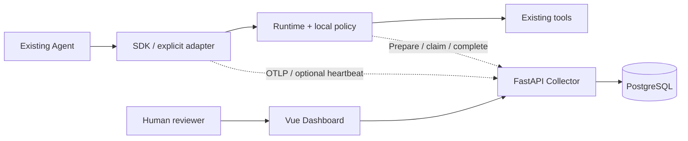

# Aegis Architecture

当前实现是 Agent 进程内的 SDK / Runtime，加单个 FastAPI Collector、PostgreSQL 和 Vue Dashboard。服务本身不调用 LLM。

## 组件与依赖

| 目录 | 责任 | 边界 |
| --- | --- | --- |
| sdk/python | Span、上下文、JSONL/OTLP、有界导出、模型/图显式 Adapter、心跳 | 不反向依赖 Runtime；模型/框架为可选依赖 |
| policy-engine | 本地纯求值、策略检查/解释/比较 | 不访问数据库或执行工具 |
| runtime | 宿主身份、受控工具、配置与生命周期、审批 prepare/resume、受约束图恢复 | 工具仍在宿主进程；不提供沙箱或终端用户身份 |
| collector | 校验、存储、查询、审批与可选健康快照 | 模块化单体；数据库迁移 1–4；健康仅进程内 |
| dashboard | 轨迹、事件、审核、策略工作台与健康阅读 | 只调用 API；不执行工具；凭证仅页面内存 |
| examples / tests | 合成业务配方、契约与跨模块验证 | 不需要真实模型凭证；真实 Provider 验收范围单列 |

## 观测数据流

装饰器/Wrapper/Adapter 在显式边界建立 Span，私有 OTel Provider 保留宿主配置。结束的 Span 进入有界内存队列，由后台线程导出；满队列和失败有累计诊断，异常退出可能丢数据。Collector 校验限定 Aegis 映射并按标识去重，Dashboard 查询已接收数据。模型用量保留未知值与维度覆盖；流式耗时含消费/关闭生命周期，不等于服务端推理时间。

049 的心跳独立于导出线程，发送有界活动标识和计数。Collector 用接收单调时间判断 45 秒失联，保留最近快照。重启清空，多进程 Collector 不共享该状态。它不提供持久 live Span，也不证明业务停止。

## 工具控制与人工审批

Runtime 接受可信宿主绑定的身份/权限，在调用受保护工具前按本地 Policy v2 求值。allow 执行；deny 零执行；require_approval 准备绑定并返回待审核票据，业务尚未执行。SDK 的 permission 标签本身没有拦截能力。

申请、审核和执行 token 互异。执行协议固定参数、工具版本、身份、策略及动作；审核者明确阅读完整参数后决定。批准不会执行工具，宿主需要显式恢复，重新验证绑定并领取一次。领取永久消费，失败/取消/未知不能自动再领；工具副作用与结果上报不是同一事务。

LangGraph 审批驱动仅覆盖约定单根中断。SQLite checkpoint 支持本机独立进程恢复；宿主持有图、模型客户端和连接。工具完成、服务端结果与图 checkpoint 非共同事务，无多机/通用多中断/跨系统恰好一次保证。

## 协议与安全边界

当前 API 快照为 [049 OpenAPI](specs/049-runtime-health/contracts/openapi.json)。旧 snapshots 保留兼容历史。OTLP 映射、应用配置与审批协议分别有版本；图状态不等于服务端动作授权。

默认遥测不含输入/输出/异常正文；执行审批会显式保存完整参数。应用上报身份和治理事件不是可信审计证据。静态 token 只分粗粒度角色，无租户隔离、用户 SSO/RBAC、防篡改存储或生产数据生命周期管理。详细支持与缺口见 [能力边界](docs/capabilities.md)。

## 部署与后续

Compose 三服务默认只绑定 localhost；审批角色默认关闭，配置后重建服务启用。数据库卷持久保存，普通 down 不删卷。见 [本地部署](deploy/docker/README.md)。

Redis、ClickHouse、MCP Gateway、Java 等仍是候选方向，不是当前运行依赖。后续优先解决 [路线图](ROADMAP.md) 中的完整使用场景。具体历史取舍保留在 [ADR](docs/README.md) 与 [SPEC 分类目录](specs/README.md)。
