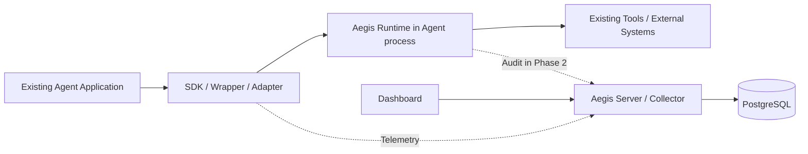

# Aegis

**Open Source Runtime Governance Layer for AI Agents**

> Observe every agent decision. Control every agent action.

Aegis 是面向 AI Agent 的开源运行时治理平台，目标是让 Agent 的执行过程可观测、工具操作可控制、治理决策可审计。它接入已有 Agent 应用，保留应用自身的框架、模型和工具。

Aegis 服务本身无需 LLM 或模型凭证。Agent 使用模型时，通过显式 Wrapper / Adapter 记录调用开始、结束、耗时和可获得的用量；模型请求仍由 Agent 自己发起。当前流式耗时覆盖调用和消费至结束/关闭/取消的生命周期，不等同于模型服务端纯推理时间，也未单独测量首 Token 延迟。未接入的任意模型调用不会被自动发现。

## 当前状态

项目处于 **Phase 2P：策略驱动的人工审批闭环**，按 [Spec 驱动流程](specs/README.md) 开发。已实现原生 Python Agent / Tool 追踪、本地 JSONL 和官方 OTLP 网络导出，以及 FastAPI Collector、PostgreSQL 幂等存储、Trace 查询、Vue Dashboard 和本地 Compose 配置。

[SPEC-045](specs/045-policy-approval/tasks.md)已交付Policy v2的allow / deny / require_approval、配置v4同步/异步策略工具、人工决定后显式单次恢复，以及请求/执行事件关联与离线评估。376项Python（含57项真实PostgreSQL）和102项前端完整回归通过，独立安装及真实页面闭环已验证。服务本身仍无需LLM；生产身份、多机协调和跨系统恰好一次未交付。

[SPEC-020](specs/020-security-events/spec.md)交付安全事件中心：跨Trace查询治理决策、按身份/工具/权限/时间等筛选、分页并跳转原Trace；允许与业务异常/取消分别展示。包含真实SDK→HTTP→PostgreSQL→生产页面闭环和[无需LLM的示例](examples/security-events/README.md)。身份仍是应用上报元数据，当前不是完整或不可篡改审计；使用与边界见[安全事件指南](docs/security-events.md)。后续每个SPEC优先交付可独立使用的完整功能，连同文档、示例和验收证据一起完成。

[SPEC-001](specs/001-python-sdk/spec.md) 定义基础 SDK；[SPEC-002](specs/002-collector/spec.md) 定义传输、存储、查询与部署，实际结果见 [验收记录](specs/002-collector/tasks.md)。[SPEC-003](specs/003-dashboard/spec.md) 定义已实现的 Trace 列表、父子树、时间线与节点详情，验证状态见 [Dashboard 验收](specs/003-dashboard/tasks.md)。[SPEC-004](specs/004-openai/spec.md) 已实现 OpenAI 同步/异步、非流式/流式 Wrapper，完成官方 SDK 合成 HTTP/SSE 的离线验收，见 [记录](specs/004-openai/tasks.md)。[SPEC-005](specs/005-deepseek/spec.md) 完成 DeepSeek Chat 同步/异步、流式与工具循环的离线及 6 请求真实验收。[SPEC-006](specs/006-langgraph/spec.md) 已完成真实 LangGraph StateGraph / ToolNode 的 invoke / ainvoke 显式接入与离线验收。[SPEC-007](specs/007-langgraph-stream/spec.md) 已完成图 stream / astream 的完整消费、提前关闭、异常和取消追踪；[SPEC-009](specs/009-runtime-policy/spec.md) 已实现宿主绑定身份、本地 allow / deny 策略和实际工具拦截；[SPEC-010](specs/010-approval-records/spec.md) 已实现持久化审批准备、人工决定和独立审核页面，批准记录不执行工具；[SPEC-011](specs/011-reviewed-execution/spec.md) 已加入完整参数审阅与显式同步工具单次恢复；[SPEC-012](specs/012-async-reviewed-execution/spec.md) 已扩展异步工具恢复与取消边界；[SPEC-013](specs/013-langgraph-reviewed/spec.md) 已加入单个同步顶层LangGraph中断的受约束恢复；[SPEC-014](specs/014-durable-graph/spec.md) 已验证本机SQLite与独立进程恢复；[SPEC-015](specs/015-async-graph/spec.md) 扩展原生异步图与宿主管理的SQLite连接；图事件投影和多机恢复仍待实现。许可证和公开分发名称待确认；当前分发名仅用于本地开发。

## 快速开始

已安装 Python 3.11+ 并取得本仓库后，一条命令创建独立环境、安装核心 SDK、运行离线 Agent 并校验本地 Trace：

```text
python scripts/quickstart.py
python scripts/quickstart.py --profile langgraph
```

不需要模型凭证。默认从官方 PyPI 安装；每次结果保存在独立的 artifacts/onboarding 目录。首条命令用于原生 Python，第二条可选验证真实 LangGraph 与合成模型。具体前提、本地缓存、耗时口径、已有 Agent 接入和后续 Dashboard 步骤见 [快速开始](docs/quickstart.md)；验收状态见 [SPEC-008](specs/008-onboarding/tasks.md)。

按接入阶段继续：

| 场景 | 入口 |
| --- | --- |
| 已有Agent统一装配Policy、工具控制与SDK生命周期 | [配置接入](docs/application-onboarding.md)，包含只读检查、原生/真实LangGraph同步异步及平台闭环 |
| 策略统一决定允许、拒绝或需要人工审批 | [策略审批闭环](docs/policy-approval.md)，Policy v2 / 配置v4、同步异步及原生/真实LangGraph示例 |
| 配置敏感工具、人工审核后显式恢复一次 | [配置审批](docs/configured-review.md)，同步/异步与独立宿主进程，v1普通工具保持 |
| 配置LangGraph暂停、独立审核、新进程恢复并继续图 | [配置审批图](docs/configured-graph.md)，同步/异步、本机SQLite、精确checkpoint绑定 |
| 已有图的四种调用、流关闭/取消、模型/工具完整观测 | [统一图调用](docs/managed-graph-stream.md)，invoke/ainvoke/stream/astream、SDK会话生命周期与完整离线示例 |
| 精简工作台、审批队列与常用/更多筛选 | [Dashboard设计与操作](docs/dashboard-design.md)，明确本页范围、参数确认、ID复制与窄屏导航 |
| 复制查询、历史恢复与详情返回原查询 | [查询链接](docs/query-links.md)，Trace与安全事件、UTC时间边界、独立认证 |
| 排查Collector就绪、查询凭证和已知Trace | [平台诊断](docs/platform-diagnostics.md)，标准库只读命令与分阶段报告 |
| 验收已安装的私有开发快照 | [统一检查](docs/snapshot-check.md)，独立报告、全部Python/真实PG与前端、工作树摘要一致性 |
| 为界面准备可重复合成演示数据 | [Dashboard演示](docs/dashboard-demo.md)，无真实模型调用，可选完整参数待审核记录 |
| 编写策略、解释决策和批量验收 | [策略工作台](docs/policy-workbench.md) |
| 比较基准/候选规则及用例变化，安排CI审查 | [策略变更评估](docs/policy-comparison.md) |
| 查询治理事件并保存可核验的JSONL/CSV | [事件中心](docs/security-events.md)、[离线排查包](docs/security-export.md) |
| 根据真实导出事件评估候选，不执行原工具 | [历史决策回放](docs/event-policy-replay.md) |

[SPEC-040](specs/040-call-duration/tasks.md)已完成调用耗时排查：按已接收模型/工具Span排行，保留0ns和精确时间，从排行定位并复制节点链接。操作及计时范围见[Trace阅读指南](docs/trace-reading.md)。

## 为什么需要 Aegis

Agent 应用进入生产环境后，开发者需要回答：一次请求经过哪些步骤、调用了哪些模型与工具、在哪里失败、消耗了多少 Token，以及一次敏感操作为什么被允许或阻止。

Aegis 围绕这些问题建立完整执行上下文，并在实际工具调用前接入权限、策略和审批流程。首个版本先完成可观测性闭环，为后续运行时控制提供基础。

## 产品能力与实施顺序

| 能力 | 目标 | 阶段 |
| --- | --- | --- |
| Agent Observability | Agent Run、LLM / Tool Span、错误、时延、Token、Trace Tree / Timeline | Phase 1 |
| Runtime Security | 工具权限声明、执行前拦截、allow / deny / require_approval、审计事件 | Phase 2 |
| Human Approval | 敏感动作暂停、人工审核、受约束的恢复执行 | Phase 2 |
| Risk Assessment | 风险评分、提示注入及异常行为检测 | Phase 3 |
| Audit / Replay | 关联执行与治理记录，按时间线回放已记录行为 | 审计从 Phase 2 开始；回放后续扩展 |
| Ecosystem | 更多框架、MCP Gateway、Java 等接入 | Phase 4 持续扩展 |

可观测性记录应用明确暴露的步骤、模型输入输出和工具行为；不假设能够获取模型内部思维过程。输入输出内容默认不采集，显式开启后仍需脱敏。回放首先指查看历史记录；重新执行真实工具属于独立的未来能力。

## 接入理念

**已有 Agent 应用应在几分钟内完成基础接入。** 支持多种接入方式，逐步实现和验证：

1. **显式 SDK / Decorator**：自定义 Python Agent 标记入口、工具和必要的步骤。
2. **SDK Wrapper**：封装支持的模型客户端，捕获 LLM 调用，同时保持调用行为。
3. **Middleware / Framework Adapter**：使用框架提供的回调或生命周期钩子关联 Agent、LLM 和 Tool。
4. **Automatic Instrumentation**：成熟适配器之上的可选便捷入口，明确支持范围与启停方式。

已实现的原生 Python API；应用启动时先初始化 SDK：

```python
import aegis
from aegis import observe, tool

aegis.init(service_name="order-service", output_path="artifacts/traces.jsonl")

@tool(permission="orders.read")
def lookup_order(order_id: str):
    return order_store.lookup(order_id)

@observe
def customer_agent(query: str):
    return existing_agent.invoke(query)
```

入口装饰器只能确定 Agent 调用边界。LLM、Tool 和 Memory 的细粒度记录需要相应装饰器、Wrapper 或 Adapter；单独使用 SDK 的 permission 仍只记录元数据；实际工具控制需要显式接入 Runtime。

首批按 **原生 Python → OpenAI 兼容客户端 → LangGraph** 推进；用户指定的 DeepSeek Provider 作为兼容客户端增量先接入。原生 Python 与 OpenAI SDK 先完成最小闭环，LangGraph 紧接着验证成熟框架中的接入体验。OpenAI Agents SDK 与 OpenAI 模型客户端 SDK 是不同适配对象，单独验证。LangChain、CrewAI、AutoGen、MCP、Spring AI 和 Semantic Kernel 随后逐步扩展。

## 架构概览



SDK 负责观测与导出；Runtime 位于 Agent 进程内，负责后续工具执行前的控制；Collector 接收数据、持久化并提供查询 API。首版服务端采用模块化单体，目录拆分不意味着每个模块独立部署。

## 技术路线

| 层 | 已选方向 | 实施边界 |
| --- | --- | --- |
| SDK / Runtime | Python 优先 | 保持核心与具体 Agent 框架解耦；Java 后续扩展 |
| Server / Collector | Python、FastAPI | 单个服务进程承载接收、查询和后续管理 API |
| Storage | PostgreSQL | MVP 使用一种持久化数据库 |
| Dashboard | Vue 3、TypeScript、ECharts | 先实现 Trace 列表、详情与时间线 |
| Deployment | Docker Compose | PostgreSQL + Collector + Dashboard 本地启动 |
| Telemetry | OpenTelemetry、GenAI Semantic Conventions | 对齐标准；实现前锁定版本与映射，兼容性需验证 |
| 后续基础设施 | Redis、ClickHouse | 分别按审批协调和数据规模需求引入 |

Redis 和 ClickHouse 保留原讨论的技术方向，首个本地闭环只依赖 PostgreSQL。标准参考入口见 [数据模型设计](docs/design/data-model.md)。

## 仓库结构

```text
aegis/
├── README.md
├── ARCHITECTURE.md
├── ROADMAP.md
├── CONTRIBUTING.md
├── requirements-dev.lock
├── scripts/quickstart.py              # 独立环境安装与首个有效 Trace 验证
├── specs/                            # 需求契约、方案与验收
├── resources/                        # 官方资料索引与研究笔记
├── sdk/
│   ├── python/src/aegis/
│   │   ├── tracing/
│   │   ├── decorators/
│   │   ├── exporters/
│   │   ├── integrations/{openai,langgraph}/
│   │   └── langgraph.py               # 显式图调用边界
│   └── java/                         # 后续语言支持
├── runtime/src/aegis_runtime/         # Agent 侧执行上下文与拦截
├── collector/src/aegis_collector/
│   ├── api/
│   ├── ingestion/
│   └── storage/
├── collector/src/aegis_collector/storage/migrations/
├── policy-engine/src/aegis_policy/    # Phase 2 策略模块
├── dashboard/src/{api,components,views}/
├── examples/{native-python,openai,langgraph}/
├── docs/
│   ├── design/
│   └── adr/
├── tests/{contract,integration,e2e,fixtures}/
└── deploy/docker/                    # Collector 镜像与可选离线依赖
```

Python SDK 与 Collector 已有实现、安装配置和验收测试；Dashboard 已有 Vue 工程；Runtime、Policy 已有最小可安装实现；首批 LangGraph 接入实现于 aegis/langgraph.py。各组件的 `tests/` 放组件验证，仓库级 `tests/` 预留跨模块验证。`specs/` 保存开发契约与任务状态，`resources/` 保存网上资料索引和研究笔记。

## 运行原生示例

在仓库根目录使用 Python 3.11+；本次实际验证为 Python 3.12.14。创建并激活独立环境后：

```text
python -m pip install -r requirements-dev.lock
python -m pip install --no-build-isolation --no-deps -e ./sdk/python
python examples/native-python/agent.py
python -m unittest discover -s sdk/python/tests -v
```

示例无需模型凭证，生成 `artifacts/native-python/traces.jsonl`：一次成功查询和一次预期失败，共 2 次 Agent Run / 4 个 Span。JSONL 是本地调试格式；网络模式使用 OTLP/HTTP binary Protobuf。详情见 [原生示例说明](examples/native-python/README.md)。

## 运行原生 Agent 可视化闭环

按上面的 Python 环境安装后，再安装 Collector：

```text
python -m pip install --no-build-isolation --no-deps -e ./collector
docker compose up -d --build --wait
```

PowerShell 中运行网络示例与查询：

```powershell
$env:AEGIS_API_TOKEN = "aegis-local-dev"
python examples/native-python/agent.py --endpoint http://127.0.0.1:8000/v1/traces
$headers = @{ Authorization = "Bearer $env:AEGIS_API_TOKEN" }
Invoke-RestMethod http://127.0.0.1:8000/api/v1/traces -Headers $headers
```

示例新增 2 个 Trace / 4 个 Span。打开本地 Dashboard `http://127.0.0.1:8080`，输入相同 Bearer token，查看成功/失败执行、父子关系和时间线。token 仅保存在当前页面内存，刷新需重新输入。服务接收 Aegis 原生 Agent / Tool、v2 LLM 和 graph v1 Agent Span；模型用量在节点中查看，Trace 用量汇总和费用估算尚未实现。配置、数据持久化、停止方法见 [本地部署](deploy/docker/README.md)，33 个自动化测试方法的证据见 [SPEC-002](specs/002-collector/tasks.md)。

## 运行 OpenAI 离线示例

按上述锁文件安装后，无需模型凭证即可运行官方 SDK 的合成 HTTP/SSE transport：

```text
python examples/openai/agent.py
python examples/openai/agent.py --api chat --stream --async
python examples/openai/agent.py --stream --endpoint http://127.0.0.1:8000/v1/traces
```

网络模式沿用上面的 `AEGIS_API_TOKEN`。每次得到 Agent / LLM / Tool 三个 Span；输入 / 输出用量来自合成响应，不代表真实模型调用。生产接入将客户端改为 `AegisOpenAI` / `AegisAsyncOpenAI`，或调用 `wrap_openai(existing_client)`，具体能力、类型限制与可选 live 步骤见 [OpenAI 示例](examples/openai/README.md)。本轮未发起真实 OpenAI Provider 请求；DeepSeek 真实验证见 SPEC-005。

## 运行 DeepSeek 示例

沿用锁定环境，无需凭证默认离线：

```text
python examples/deepseek/agent.py
python examples/deepseek/agent.py --stream --async
python examples/deepseek/agent.py --tool-loop
```

公共入口 `from aegis.deepseek import AegisDeepSeek, AegisAsyncDeepSeek`，或 `wrap_openai(client, provider="deepseek")`；只追踪本增量支持的 Chat create。4 种调用组合与两轮模型 / 一次合成工具循环已通过真实 HTTP / PostgreSQL / Dashboard。可选 live 只使用本机 DEEPSEEK_API_KEY 和显式 DEEPSEEK_MODEL，不使用 OPENAI_API_KEY。deepseek-flash 的 6 个真实请求已成功，形成额外 5 Trace / 16 Span，见 [步骤与范围](examples/deepseek/README.md) 和 [任务记录](specs/005-deepseek/tasks.md)。

## 运行真实 LangGraph 离线 Agent

锁定环境已包含 LangGraph 1.2.15、langchain-core 1.6.12 与 prebuilt 1.1.1；无需外部模型或 LangSmith 凭证：

```text
python examples/langgraph/agent.py
python examples/langgraph/agent.py --async
python examples/langgraph/agent.py --fail-tool
```

示例真正运行 StateGraph / ToolNode，模型 transport 为合成数据。接入前后结果与模型/工具次数一致；接入后形成 1 Agent + 2 LLM + 1 Tool。公共入口 `observe_graph(graph)` 支持 invoke / ainvoke / stream / astream；三个显式接入点、范围与本机测量见 [示例](examples/langgraph/README.md) 和 [验收](specs/006-langgraph/tasks.md)。本轮没有新增真实模型请求。

图流式示例同样默认离线，接入前后对照输出与调用次数：

```text
python examples/langgraph/stream.py
python examples/langgraph/stream.py --async --early-close
python examples/langgraph/stream.py --fail-tool --endpoint http://127.0.0.1:8000/v1/traces
```

提前停止请使用 with / async with 或显式 close / aclose。图流只在首次取值启动，消费者处理 chunk 时恢复原上下文；没有 state / chunk 内容采集。当前 85 个 Python + 23 个前端测试方法通过，8 Trace / 24 Span 经真实 HTTP、数据库与页面核对，详见 [007 验收](specs/007-langgraph-stream/tasks.md)。本轮没有新增真实模型请求。

## 运行工具权限控制

现有 SDK 环境下安装两个可选本地包后，运行可计数的合成工具：

```text
python -m pip install --no-build-isolation --no-deps -e ./sdk/python -e ./policy-engine -e ./runtime
python examples/runtime-policy/agent.py
python examples/runtime-policy/agent.py --async
```

公共入口 Runtime(policy=validated_policy, subject="order-agent")，用 runtime.tool(permission="orders.read") 替换原工具装饰器。显式拒绝优先、未匹配默认拒绝；缺身份/权限/策略或求值故障均不调用工具。示例执行次数为允许 1、显式拒绝 0、默认拒绝 0、允许后业务异常 1。同步/异步共 8 Trace / 16 Span 已经真实 Collector / PostgreSQL / Dashboard 核对，137 个自动化方法通过。步骤与适用边界见 [示例](examples/runtime-policy/README.md) 和 [009 验收](specs/009-runtime-policy/tasks.md)。

这是宿主显式接入的进程内控制，不是沙箱或外部用户认证；异步遥测不是持久审计。审批和显式工具恢复由后述SPEC-010/011/012提供。

## 从这里继续开发

- [ARCHITECTURE.md](ARCHITECTURE.md)：组件职责、数据流、执行控制与部署边界。
- [ROADMAP.md](ROADMAP.md)：阶段范围、验收条件和下一步开发顺序。
- [接入设计](docs/design/integrations.md)：候选 SDK API、适配顺序和接入验证方法。
- [数据模型](docs/design/data-model.md)：Trace / Span / Governance Event 的草案。
- [MVP 验收方案](docs/design/mvp.md)：真实 Agent 到 Dashboard 的闭环。
- [架构决策记录](docs/adr/0001-foundation.md)：首版取舍及待确认事项。
- [CONTRIBUTING.md](CONTRIBUTING.md)：开发约定和验证要求。

开发流程见 [Specs](specs/README.md)，官方资料见 [Resources](resources/README.md)。LangGraph 首批接入见 SPEC-006，图流式生命周期及平台验收见 SPEC-007。SPEC-008 已完成独立环境快速开始与本地缓存测量：原生约 33.6 秒、LangGraph 约 177.3 秒，均含安装到有效 Trace 校验；这两个数值不含在线下载、人工修改和平台首次可见。Docker 恢复后的独立平台续验已通过：三服务健康约 26.2 秒、首次查询约 44.3 秒、列表与详情确认上界约 107.9 秒；5 分钟目标仍待人工验收。SPEC-009 已进入最小 Runtime allow / deny；后续先设计审批持久化与动作绑定，再考虑恢复执行。事件投影与 checkpoint 恢复仍按独立 spec 扩展；真实 OpenAI Provider 与框架内真实模型另行验收。

## 设计原则

- **Developer First**：优先降低已有 Agent 的接入成本，记录修改行数与接入耗时。
- **Framework Agnostic**：稳定核心契约，通过外围适配器扩展框架支持。
- **Open Standards**：复用 OpenTelemetry，上层治理字段明确命名与版本。
- **Runtime First**：策略控制发生在受保护工具执行之前。
- **Incremental Delivery**：先验证真实使用流程，再扩展风险引擎和生态。

## 许可证

目标是开源项目，具体许可证尚未选定；当前按用户选择准备GitHub私有开发仓库，不声明已有开源授权。私有上传就绪与公开发布是不同门槛，见 [发布准备](docs/github-readiness.md)。

## 持久审批准备：SPEC-010

ApprovalClient 本地参数 HMAC / 策略快照绑定，Collector 迁移3、独立 producer/reviewer 角色、并发与时效控制，Dashboard“审批准备”已接入。批准/拒绝只记录决定，不覆盖 Runtime 策略、不执行工具。配置、示例和限制见 [审批接入](docs/approvals.md)，验收见 [010](specs/010-approval-records/tasks.md)。后续先定义单次领取、执行确认与未知结果处理，再实现 Agent 恢复。

## 单次同步恢复：SPEC-011

显式ReviewedTool在本地allow之外增加人工审批，完整具名JSON参数含默认值需宿主主动披露。第三种独立执行凭证、数据库原子领取和幂等结果确认已接入；claimed/unknown永不释放或自动重试。旧010准备记录仍不能执行。配置与限制见 [执行审批接入](docs/reviewed-execution.md)，验收见 [011](specs/011-reviewed-execution/tasks.md)。仅普通同步函数；Policy DSL require_approval、异步与LangGraph checkpoint恢复分别待实现。

## 异步执行审批：SPEC-012

AsyncReviewedClient / AsyncReviewedTool复用011协议，支持普通async def的显式prepare/resume与原生异步HTTP。取消可能留下claimed未知，保持单次领取且不自动重试；成功返回原value，业务异常/取消保持身份。HTTPX通过reviewed-async extra可选安装，核心服务仍不依赖LLM。见 [接入](docs/async-reviewed-execution.md)、[示例](examples/async-reviewed-execution/README.md) 与 [验收](specs/012-async-reviewed-execution/tasks.md)。LangGraph checkpoint/interrupt和require_approval分支仍未实现。

## LangGraph审批恢复：SPEC-013

ReviewedGraphTool提供纯interrupt节点与宿主驱动的prepare/resume，绑定thread/checkpoint/interrupt、规范化实参和版本。节点重跑不重复真实工具；同一逻辑call使用稳定action，未知不重领。仅同步单个根中断，已验证真实HTTP/PG及InMemorySaver下宿主对象重建；跨进程checkpoint持久化未验收。见 [接入](docs/langgraph-reviewed.md)、[示例](examples/langgraph-reviewed/README.md) 和 [013证据](specs/013-langgraph-reviewed/tasks.md)。

## 本机持久图：SPEC-014

可选官方SqliteSaver、版本化本机文件和严格serializer已接入；start/status/resume分进程保留原checkpoint/ticket/action，人工批准后只执行一次。五个真实硬退出边界均不重复工具副作用；确认完成但图未继续时保守保持暂停。仅本机单个同步宿主，不是多机调度或跨库恰好一次。见 [接入](docs/durable-graph.md)、[示例](examples/durable-graph/README.md) 和 [014验收](specs/014-durable-graph/tasks.md)。

## 原生异步审批图：SPEC-015

AsyncReviewedGraphTool原生await工具、checkpoint和图继续，保留取消与Agent上下文；宿主以async with管理官方SQLite连接，Aegis校验格式后配置saver。领取永久消费、未知不重试，沿用原协议/四迁移/62依赖版本。见 [接入](docs/async-graph.md)、[示例](examples/async-durable-graph/README.md) 与 [015验收](specs/015-async-graph/tasks.md)。

## 已有Agent接入配方：SPEC-016

新增独立原Agent与适配层，通过同步/异步观测、Runtime allow/deny对照验证接入；不改SDK/服务端API。先按 [接入选择](docs/existing-agent.md) 确定能力，再运行 [示例](examples/existing_agent/README.md)。一行宿主导入差异仅是本例接线，不含适配层和SDK生命周期；人工5分钟接入仍待实测。见 [016验收](specs/016-existing-agent/tasks.md)。

## 接入前检查：SPEC-017

用 `python scripts/doctor.py --profile native` 检查当前解释器和选定关键包版本；langgraph与reviewed-async-graph profile覆盖相应入口。默认不读取凭证、不导入或运行Agent、不联网。元数据通过不等于业务接入/平台验证；见 [检查说明](docs/preflight.md) 与 [017验收](specs/017-preflight/tasks.md)。

## GitHub私有仓库准备：SPEC-018

统一测试入口、候选文件检查和只读CI配置已补齐。当前按用户选择准备私有开发快照，许可证/公开发布/发包独立处理。实际结果与首次远端CI待验收项见 [清单](docs/github-readiness.md) 和 [018验收](specs/018-private-repository/tasks.md)。

## Trace模型用量汇总：SPEC-019

执行详情汇总当前已接收模型节点的输入/输出Token，显示各维度数据覆盖；任一项缺失时该项总数保持未知，真实0不被混淆。BigInt保留大整数，费用未估算，不保证Trace到齐或覆盖所有调用。见 [说明](docs/trace-usage.md) 与 [019验收](specs/019-trace-usage/tasks.md)。
